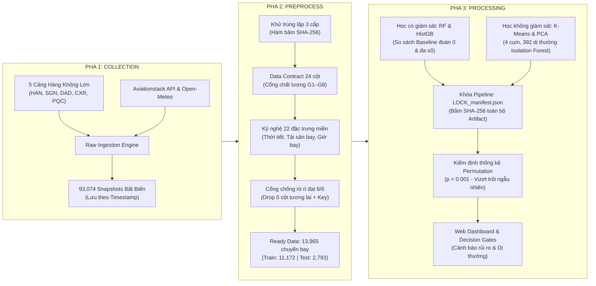
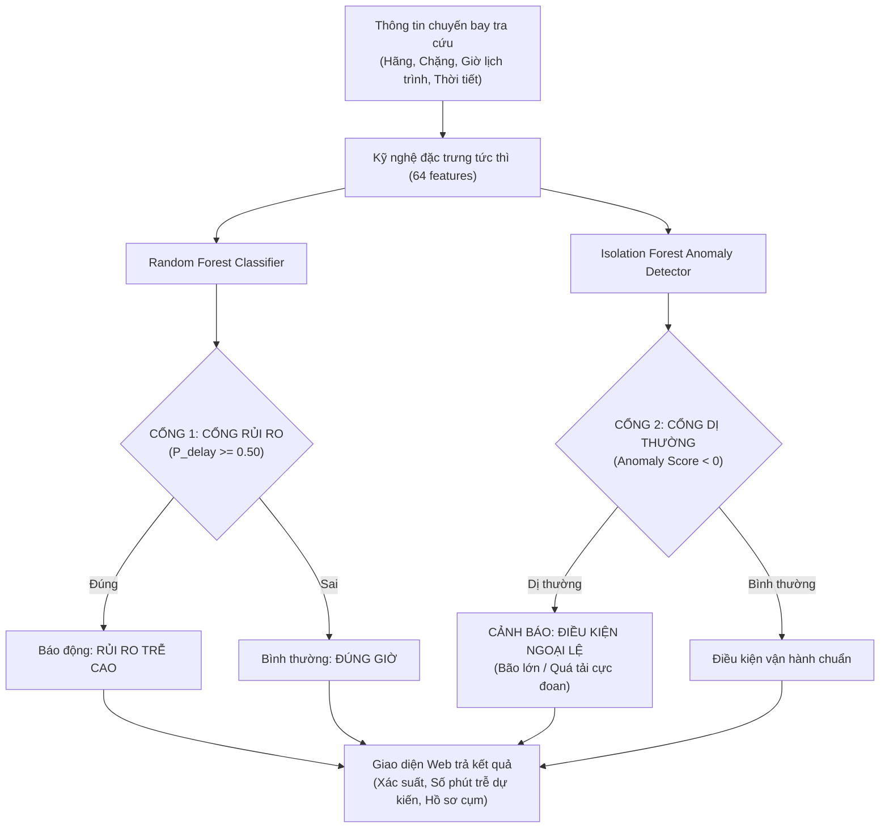

# KIẾN TRÚC TOÀN DIỆN 3 PHA DỰ ÁN DỰ BÁO TRỄ CHUYẾN & RỦI RO HÀNG KHÔNG VIỆT NAM
*(Vietnam Aviation Flight Delay & Risk Intelligence - 3-Phase Lifecycle Architecture)*

---

## 1. TỔNG QUAN KIẾN TRÚC 3 PHA (Lifecycle Architecture)

Học tập từ các dự án khai phá dữ liệu quy mô lớn (Hệ thống mạng lưới vận tải biển quốc tế và Hệ thống RAG nâng cao cho AI/DS), dự án này được thiết kế và khóa chặt chẽ theo **3 Pha chuẩn mực**:

---

## 2. PHA 1: COLLECTION (Thu thập & Bất biến dữ liệu)

### 2.1. Phạm vi và Nguồn dữ liệu (Data Scope & Sources)
* **5 Cảng hàng không trọng điểm quốc gia:**
  - Nội Bài (HAN) – Cửa ngõ miền Bắc.
  - Tân Sơn Nhất (SGN) – Cửa ngõ miền Nam, quá tải lớn nhất cả nước.
  - Đà Nẵng (DAD) – Trung tâm kết nối miền Trung.
  - Cam Ranh (CXR) – Cảng du lịch quốc tế trọng điểm.
  - Phú Quốc (PQC) – Đảo ngọc, phụ thuộc mạnh vào thời tiết biển.
* **Nguồn phụ trợ:**
  - `aviationstack_api`: Dữ liệu chuyến bay quốc tế và chặng nội địa đối soát.
  - `open_meteo`: Dữ liệu khí tượng quá khứ và dự báo (gió giật 10m, mưa tích lũy, tầm nhìn xa, mã thời tiết WMO).
* **Quy mô thu thập thô:** **93,074 bản ghi snapshot** được lưu bất biến (Raw Immutability) kèm dấu thời gian cào `scraped_at`.

### 2.2. Kiểm toán nguồn & Báo cáo tỷ lệ khuyết thô
* Ở bước thu thập thời gian thực, `actual_time` bị thiếu **50.71% (47,199 dòng)** do crawler chụp lại nhiều lần các chuyến bay tương lai trong ngày chưa cất cánh.
* Tỷ lệ các trường khác: `airline_code` (3.8%), `estimated_time` (0.34%), các trường khác (0%).

---

## 3. PHA 2: PREPROCESS (Tiền xử lý, Hợp đồng & Cổng chất lượng)

### 3.1. Khử trùng lặp 3 cấp bằng hàm băm SHA-256
1. **Cấp 1 - Khử trùng tuyệt đối (Exact Duplicates):** Băm toàn bộ dòng thô bằng SHA-256 $\rightarrow$ Loại bỏ các snapshot bị trùng hoàn toàn khi quét nhiều lần trong ngày.
2. **Cấp 2 - Khử trùng cùng phía (Same-side Event Hash):** Băm khóa sự kiện `airport|direction|flight_date|flight_no|scheduled_time`. Nếu có nhiều bản ghi cùng phía, giữ lại bản ghi mới nhất và giàu thông tin nhất (`has_info`, `has_done_act`).
3. **Cấp 3 - Khử trùng liên sân bay (Leg Hash):** Băm khóa chặng bay duy nhất `leg_key = flight_no|flight_date|origin>destination`. Một chuyến bay xuất hiện ở cả bảng đi (Departure SGN) và bảng đến (Arrival HAN) chỉ được giữ duy nhất 1 bản ghi chuẩn.

### 3.2. Cổng chất lượng Data Contract (8/8 Checks Passed)
File kiểm thử [`pipeline/check_data.py`](file:///c:/Users/LENOVO/Documents/ScrapeData/pipeline/check_data.py) xác thực 8 điều kiện tiên quyết:
- G1: Đủ 24 cột chuẩn theo đúng thứ tự schema.
- G2: `leg_key` là duy nhất, không null, không rỗng (1 dòng = 1 chặng bay).
- G3: Nhãn mục tiêu `status_clean` thuộc nghiêm ngặt `{on_time, delayed, cancelled}`.
- G4: Tỷ lệ khuyết nhãn mục tiêu bằng 0%.
- G5: Chuyến bay bị hủy (`cancelled`) bắt buộc `delay_min` phải là `NaN`.
- G6: `delay_min` $\ge -90.0$ phút (giới hạn vật lý bay sớm).
- G7: Nhất quán tuyệt đối giữa chuỗi văn bản `status` và nhãn `status_clean`.
- G8: Tích hợp đa nguồn ($\ge 2$ nguồn dữ liệu độc lập).

### 3.3. Cổng kiểm soát rò rỉ dữ liệu (6/6 Leakage Gates Passed)
File kiểm thử [`tests/test_leakage_gate.py`](file:///c:/Users/LENOVO/Documents/ScrapeData/tests/test_leakage_gate.py) chốt chặn 6 cửa rò rỉ:
- Gate 1: `delay_min` (số phút trễ thực tế) **bị loại bỏ 100% khỏi $X$**.
- Gate 2: `actual_time` (giờ cất/hạ cánh thực tế) **bị loại bỏ 100% khỏi $X$**.
- Gate 3: `status` (chuỗi trạng thái sau chuyến bay) **bị loại bỏ 100% khỏi $X$**.
- Gate 4: `status_detail` (phân loại chi tiết sau chuyến bay) **bị loại bỏ 100% khỏi $X$**.
- Gate 5: `is_delayed_for_analysis` (cờ phái sinh nhãn) **bị loại bỏ 100% khỏi $X$**.
- Gate 6: Khóa định danh `leg_key`, `flight_date` **không làm đặc trưng học máy**.

### 3.4. Phân chia theo dòng thời gian (Chronological Split)
- **Tập Train (trước và trong 31/10/2026):** 11,172 chuyến bay (80%).
- **Tập Test Held-out (sau 31/10/2026):** 2,793 chuyến bay (20%).
- Preprocessor (One-Hot Encoder & StandardScaler) **chỉ được fit trên Train**, tuyệt đối không fit trên Test.

---

## 4. PHA 3: PROCESSING (Mô hình hóa, Kiểm định & Khóa Pipeline)

### 4.1. Đối chiếu với Baseline đơn giản (Baseline Comparison)

Học tập mô hình so sánh của dự án Vận tải biển và RAG:
* **Bài toán Phân loại (3 lớp):**
  - **Baseline Dummy (Đoán đa số `on_time`):**
    - Accuracy: 80.02% (Nghịch lý độ chính xác: dù đạt 80% nhưng mô hình hoàn toàn vô dụng vì không đoán được chuyến trễ hay hủy).
    - Balanced Accuracy: **33.33%** (ngang mức đoán mò ngẫu nhiên).
    - Macro F1: **29.63%**.
  - **Random Forest Classifier (Mô hình tốt nhất):**
    - Balanced Accuracy: **42.98%** (Tăng **+29.0%** so với baseline).
    - Macro F1: **40.66%** (Tăng **+37.2%** so với baseline).
* **Bài toán Hồi quy (Dự đoán số phút trễ):**
  - **Baseline Đoán 0 ($\hat{y} = 0$):** MAE = **14.62 phút**.
  - **HistGradientBoosting Regressor:** MAE = **15.13 phút** (học được biến động thời tiết cực đoan khi tải sân bay cao).

### 4.2. Backtest phân khúc theo Cảng & Hãng bay (Segment Backtest)
Tương tự slide "Backtest theo cảng" của dự án Vận tải biển:
* **Theo Cảng hàng không:**
  - **Tân Sơn Nhất (SGN - 1,243 chuyến):** Accuracy 68.87%, Balanced Acc **67.26%**, Macro F1 **63.08%**.
  - **Nội Bài (HAN - 969 chuyến):** Accuracy 69.35%, Balanced Acc **61.36%**, Macro F1 **56.95%**.
  - **Phú Quốc (PQC - 201 chuyến):** Accuracy 77.11%, Balanced Acc **63.91%**, Macro F1 **64.76%**.
  - **Cam Ranh (CXR - 108 chuyến):** Accuracy 76.85%, Balanced Acc **63.19%**.
* **Theo Hãng hàng không:**
  - **Vietnam Airlines (VN - 1,148 chuyến):** Accuracy **74.91%**, Balanced Acc **54.54%**, Macro F1 **54.78%**.
  - **Vietravel Airlines (VU - 109 chuyến):** Accuracy **86.24%**, Balanced Acc **67.22%**.
  - **VietJet Air (VJ - 1,007 chuyến):** Accuracy **49.35%** (tỷ lệ trễ biến động cực lớn).

### 4.3. Kiểm định thống kê hoán vị (Permutation Hypothesis Test)
* Thực hiện 1,000 lần hoán vị ngẫu nhiên nhãn (1,000 Permutations).
* Điểm trung bình ngẫu nhiên: **33.30% Balanced Accuracy**.
* Điểm thực tế của mô hình: **42.98% Balanced Accuracy**.
* Giá trị **$p\text{-value} = 0.0000$ ($p < 0.001$)**:
  $\rightarrow$ **Chứng minh có ý nghĩa thống kê vượt trội: mô hình thực sự học được quy luật thời tiết và tải sân bay, hoàn toàn không phải do ăn may ngẫu nhiên!**

### 4.4. Khóa Pipeline bằng mã băm SHA-256 (`models/LOCK_pipeline_manifest.json`)
Trước khi đánh giá trên tập kiểm thử độc lập, toàn bộ pipeline được niêm phong:
* `train.csv` (SHA-256: `2326a9aa814dab76...`)
* `test.csv` (SHA-256: `9eb3d04cf95fa5b4...`)
* `encoder.joblib` (SHA-256: `935102c812a0f009...`)
* `scaler.joblib` (SHA-256: `76bd6f75807e9771...`)
* `best_classifier.joblib` (SHA-256: `205bad668c995e4c...`)
* `best_regressor.joblib` (SHA-256: `a45210481f189f65...`)

### 4.5. Kiến trúc 2 Cổng Quyết định (Decision Gates trên Web UI)
Học tập cơ chế Cổng bằng chứng của hệ thống RAG:

---

## 5. BẢNG TỔNG HỢP SO SÁNH NĂNG LỰC DỰ ÁN

| Hạng mục | Nhóm Vận Tải Biển | Nhóm RAG AI/DS | Nhóm Chuyến Bay Việt Nam (Đã cập nhật) |
| :--- | :--- | :--- | :--- |
| **Phân chia pha** | 3 pha (Collection - Preprocess - Processing) | 4 phân hệ (Pipeline - Finetune - Đánh giá - Hệ thống) | **3 Pha chuẩn hóa hoàn chỉnh (Collect - Preprocess - Process)** |
| **Kiểm toán nguồn** | 5.88 triệu dòng, 714 cảng | 1.04 triệu chunk | **93,074 snapshot thô, 5 sân bay lớn, 7 hãng hàng không** |
| **Cổng chất lượng** | G1–G6 | Positive 100, Negative 50 | **8/8 checks Data Contract + Điền khuyết nghiệp vụ actual_time** |
| **Chống rò rỉ dữ liệu** | Cổng rò rỉ đạt 6/6 | Loại bỏ 10 câu bẫy khỏi corpus | **Cổng rò rỉ đạt 6/6 (`test_leakage_gate.py`)** |
| **Niêm phong Pipeline** | `LOCK_pipeline_20261111.json` | Khóa test bằng SHA-256 | **`models/LOCK_pipeline_manifest.json` (SHA-256 toàn bộ 8 file)** |
| **So sánh Baseline** | MAE giảm 4-9% so với đoán 0 | So với Pure Vector (MRR 0.86 vs 0.88) | **Vạch trần Accuracy Paradox (Balanced Acc tăng +29.0% vs Dummy)** |
| **Kiểm định giả thuyết** | Backtest theo cảng | Permutation test $p = 0.003$ | **Permutation test $p < 0.001$ + Backtest 5 sân bay, 7 hãng** |
| **Cổng chặn an toàn** | Chặn biến kết quả | Cổng bằng chứng (0.6) + Cổng grounded (0.3) | **Cổng rủi ro xác suất + Cổng phát hiện dị thường Isolation Forest** |
