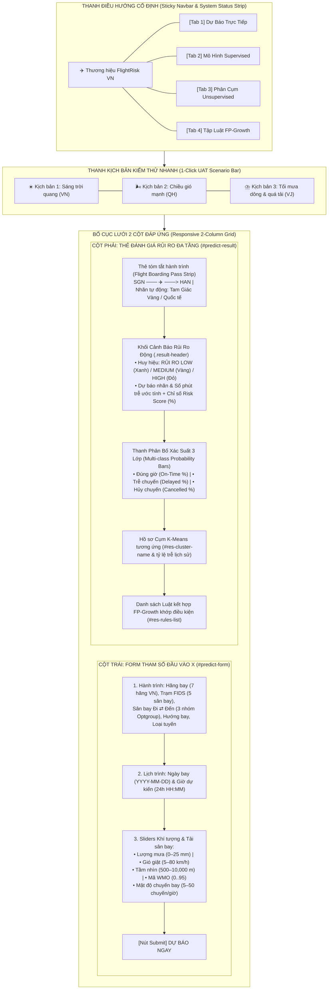

# Báo Cáo Hoàn Thiện Công Việc — Thành Viên 7 (Part 6B)

> **Phân công:** Thành viên 7 — Web Frontend UI & Interactive Simulator (Part 6B)  
> **Nhánh Git:** `feature/web-frontend`  
> **Tệp phụ trách:**
> - [`web/templates/index.html`](../web/templates/index.html)
> - [`web/static/style.css`](../web/static/style.css)
> - [`notebooks/07_member7_web_frontend_ui.ipynb`](../notebooks/07_member7_web_frontend_ui.ipynb)
> - [`tests/test_web_frontend.py`](../tests/test_web_frontend.py)

---

## PHẦN 1: NỘI DUNG ĐÓNG GÓP VÀO BÁO CÁO WORD & SLIDE (CHƯƠNG 6 — MỤC 6.2)

*(Bạn có thể sao chép trực tiếp toàn bộ mục 6.2 dưới đây vào file Báo cáo Word của nhóm)*

---

### 6.2. Thiết kế Giao diện Người dùng và Bộ Mô phỏng Tương tác (User Interface & Interactive Simulator Design)

#### 6.2.1. Triết lý thiết kế và Kiến trúc Đa phân hệ (4-Tab SPA Layout)
Giao diện người dùng của nền tảng **FlightRisk VN** được xây dựng theo kiến trúc **Single-Page Dashboard** gồm 4 phân hệ (Tabs) chuyển đổi tức thời mà không cần tải lại trang, giúp kết nối liền mạch từ bước **nhập tham số mô phỏng** đến **giải thích mô hình học máy có giám sát và không giám sát**:

1. **Tab 1 — Dự Báo Trực Tiếp (`#simulator-tab`):** Bảng điều khiển cho phép nhập thông số chuyến bay, điều chỉnh thời tiết/mật độ sân bay và nhận kết quả dự báo từ API. Mục tiêu độ trễ dưới 50 ms cần đo và xác nhận riêng với bộ model và môi trường thực tế.
2. **Tab 2 — Mô Hình Supervised (`#models-tab`):** Trình bày bảng đối chiếu hiệu năng thực nghiệm trên tập kiểm thử độc lập (Test Set chia theo thời gian) giữa *Logistic Regression*, *Random Forest*, *HistGradientBoosting*, sai số hồi quy (MAE, RMSE) và bảng xếp hạng Top 10 đặc trưng quan trọng nhất (Feature Importance).
3. **Tab 3 — Phân Cụm Unsupervised (`#clusters-tab`):** Hiển thị bảng đặc tả 4 cụm rủi ro vận hành từ thuật toán *K-Means ($k=4$)* cùng thống kê các chuyến bay dị thường từ *Isolation Forest*.
4. **Tab 4 — Tập Luật FP-Growth (`#rules-tab`):** Trực quan hóa danh sách các luật kết hợp (Association Rules) theo *Lift* và *Confidence* để tham khảo mối liên hệ thống kê; các luật không chứng minh quan hệ nhân quả.

#### 6.2.2. Bố cục Wireframe Giao diện Mô phỏng (Interactive Simulator Wireframe)



#### 6.2.3. Thiết kế Ánh xạ Các Bộ Điều khiển (Form Controls) với Kỹ nghệ Đặc trưng (Part 3)
Điểm cốt lõi trong thiết kế giao diện của **FlightRisk VN** là mọi bộ điều khiển (Dropdowns, Pickers, Range Sliders) đều tuân thủ nghiêm ngặt **Hợp đồng dữ liệu (`docs/schema.md`)** — tuyệt đối không yêu cầu bất kỳ thông tin nào xảy ra sau khi bay (`actual_time`, `delay_min`, `status`), đồng thời các mốc trên thanh trượt phản ánh chính xác ngưỡng toán học của tầng Feature Engineering:

| Thành phần UI (`id`) | Loại điều khiển | Miền giá trị / Tùy chọn | Ý nghĩa ánh xạ sang tầng Feature Engineering (`features/features.py`) |
| :--- | :---: | :--- | :--- |
| `#airline` | `<select>` | `VN`, `VJ`, `QH`, `BL`, `VU`, `0V`, `9G` | Suy ra mô hình hãng bay `carrier_category` (`FSC`, `LCC`, `HYBRID`, `TOURIST`, `REGIONAL`, `SEAPLANE`) và One-Hot Encoding. |
| `#airport` | `<select>` | `SGN`, `HAN`, `DAD`, `CXR`, `PQC` | Trạm quan sát FIDS nơi lấy dữ liệu thời tiết và tính mật độ cất/hạ cánh. |
| `#origin` $\leftrightarrow$ `#destination` | `<select>` + Nút đảo `⇄` | 5 sân bay FIDS, 9 sân bay nội địa, 4 sân bay quốc tế | Tự động xác định cờ đường bay trục vàng `is_golden_triangle` (`SGN-HAN-DAD`). |
| `#direction` & `#route-type` | `<select>` | `DEPARTURES`/`ARRIVALS`; `domestic`/`international` | Tạo cờ nhị phân `is_departure` và `is_domestic_flag`. |
| `#flight-date` & `#sched-time` | `date` & `time` | Ngày ISO & Giờ 24h `HH:MM` | Biến đổi lượng giác chu kỳ 24h (`hour_sin`, `hour_cos`), chu kỳ 7 ngày (`dow_sin`, `dow_cos`) và cờ giờ cao điểm `is_peak_hour` (06:00–09:30, 17:00–20:30). |
| `#precip` | `range` slider | `0.0` $\rightarrow$ `25.0` mm (bước `0.5`) | Kích hoạt cờ `is_rain` ($>0.1\text{ mm}$), `is_heavy_rain` ($>2.5\text{ mm}$), và trọng số $35\%$ trong `weather_hazard_score`. |
| `#wind` | `range` slider | `5` $\rightarrow$ `80` km/h (bước `1`) | Kích hoạt cờ `is_high_wind` ($>30\text{ km/h}$), `is_severe_wind` ($>50\text{ km/h}$), và trọng số $25\%$ trong `weather_hazard_score`. |
| `#vis` | `range` slider | `500` $\rightarrow$ `10,000` m (bước `500`) | Kích hoạt cờ tầm nhìn hạn chế `is_low_vis` ($<5,000\text{ m}$) và trọng số $20\%$ trong `weather_hazard_score`. |
| `#weather-code` | `<select>` | Mã WMO `0`, `1`, `45`, `61`, `65`, `80`, `95` | Kích hoạt cờ dông bão `is_storm` ($\text{WMO} \ge 95$) và cộng thưởng $+0.20$ vào `weather_hazard_score`. |
| `#load` | `range` slider | `5` $\rightarrow$ `50` chuyến/giờ (bước `1`) | Kích hoạt cờ quá tải `is_heavy_traffic` ($>28$ chuyến/giờ) và nhân tương tác phi tuyến `load_x_weather`. |

#### 6.2.4. Hệ thống Bảng màu Nhận diện Thương hiệu & Cảnh báo Rủi ro Đa cấp
Trong tệp `web/static/style.css`, bảng màu được chuẩn hóa qua hệ thống biến CSS (`:root` Design Tokens) để phân biệt các cấp rủi ro. Chưa có kết quả kiểm định đầy đủ WCAG AA cho toàn bộ giao diện.

| Nhóm màu | Biến CSS (Token) | Mã màu Hex | Ứng dụng trên Giao diện |
| :--- | :--- | :---: | :--- |
| **Nhận diện Hàng không (Brand)** | `--primary` / `--secondary` | `#1E3A8A` / `#0F172A` | Dải Header Gradient xanh đậm bầu trời đêm, nút hành động chính, tiêu đề bảng. |
| **Rủi ro Thấp (`LOW` < 25%)** | `--success` / `--success-bg` | `#10B981` / `#ECFDF5` | Khung kết quả `.risk-low` màu xanh ngọc lục bảo và thanh tiến trình `On-Time`. |
| **Rủi ro Trung bình (`MEDIUM` từ 25% đến dưới 45%)** | `--warning` / `--warning-bg` | `#F59E0B` / `#FFFBEB` | Khung kết quả `.risk-medium` màu vàng hổ phách và thanh tiến trình `Delayed`. |
| **Rủi ro Cao (`HIGH` $\ge$ 45%)** | `--danger` / `--danger-bg` | `#EF4444` / `#FEF2F2` | Khung cảnh báo `.risk-high` màu đỏ kèm viền phát sáng và thanh `Cancelled`. |

#### 6.2.5. Thiết kế Đáp ứng Đa thiết bị (Responsive Design)
Giao diện hỗ trợ 3 điểm ngắt (Breakpoints) tự động thích ứng kích thước màn hình:
* **Desktop (`> 920px`):** Bố cục lưới 2 cột đối xứng (`.grid-2` tỷ lệ `1.05fr : 0.95fr`), giúp người dùng vừa kéo thanh trượt bên trái vừa quan sát sự biến thiên của thanh xác suất bên phải mà không phải cuộn trang.
* **Tablet (`641px – 920px`):** Chuyển `.grid-2` về 1 cột dọc (`grid-template-columns: 1fr`), giữ nguyên hàng đôi (`.form-row`) bên trong form.
* **Mobile (`<= 640px`):** Xếp chồng các ô nhập trong `.form-row` thành 1 cột dọc, xoay nút đảo chiều sân bay `⇄` theo phương đứng, chia 4 nút điều hướng Tab thành lưới $2 \times 2$ dễ chạm trên màn hình cảm ứng, và bật cuộn ngang (`overflow-x: auto`) cho các bảng dữ liệu lớn ở Tab 2, 3, 4.

---

## PHẦN 2: HƯỚNG DẪN TỰ KIỂM TRA & TẠO PULL REQUEST CHO THÀNH VIÊN 7

### 1. Chạy kiểm thử tự động dành riêng cho giao diện của Thành viên 7
Từ thư mục gốc của dự án, chạy lệnh:
```bash
python -m unittest tests.test_web_frontend -v
```
Bộ kiểm thử cấu trúc và giao diện sẽ kiểm tra:
1. Sự tồn tại và dung lượng của `web/templates/index.html` và `web/static/style.css`.
2. Hợp đồng 4 Tab điều hướng (`simulator-tab`, `models-tab`, `clusters-tab`, `rules-tab`).
3. Đầy đủ 7 hãng hàng không Việt Nam và 5 trạm quan sát FIDS trong `<select>`.
4. Đúng miền giá trị `min`/`max` của 4 thanh trượt (`precip`, `wind`, `vis`, `load`) và các thẻ đọc số động (`#precip-val`...).
5. Đầy đủ 13 ID kết quả trong `#predict-result` để khớp 100% với `web/static/app.js` của Thành viên 8.
6. Đảm bảo **Zero Data Leakage** trên UI (không có bất kỳ ô nhập nào mang tên `delay_min`, `actual_time`, `status`, `status_detail`).
7. Đầy đủ các class trạng thái rủi ro (`.risk-low`, `.risk-medium`, `.risk-high`) và `@media` query trong `style.css`.

Kiểm tra trình duyệt bổ sung (tự bỏ qua nếu thiếu Playwright hoặc Chrome/Chromium/Edge):

```bash
python -m unittest tests.test_web_frontend_browser -v
```

Test trình duyệt kiểm tra preset, payload, đảo tuyến, dữ liệu hành trình sai, điều hướng và màn hình 390 px. Các test tương tác thông thường dùng phản hồi API giả lập; test kết nối API thật chỉ chạy khi `/health` sẵn sàng. Bài kiểm tra thực tế ngày 15/11/2026 trả kết quả từ API cho cả ba preset, nhưng scikit-learn vẫn cảnh báo encoder/scaler 1.9.0 khi chạy bằng 1.9.1.

Khi tích hợp, giao diện được bổ sung kiểm tra sân bay đi/đến khác nhau, trạm quan sát phù hợp hướng bay và loại tuyến phù hợp. Trạng thái trước khi có kết quả được hiển thị trung tính. Cần Thành viên 8 xử lý hiển thị lỗi API rõ ràng và làm mới thông tin thống kê động; `web/static/app.js` hiện còn ghi cứng tập test là 2.566 dòng, trong khi metrics hiện tại ghi 2.793 dòng.

Ngày 15/11/2026, trên môi trường dự án đã cài Playwright và Chrome, **76/76 bài test toàn dự án đạt**, gồm 9 bài kiểm tra cấu trúc TV7 và 5 bài kiểm tra trình duyệt. Ba preset đều gửi được request tới API thật. Đây là kiểm tra chức năng, không khẳng định model đã được hiệu chỉnh xác suất hay giao diện đạt đầy đủ tiêu chuẩn WCAG. Scikit-learn vẫn phát cảnh báo khác bản vá 1.9.0/1.9.1 khi nạp artifact; cần nhóm tiếp tục xác nhận tính tương thích.

### 2. Khởi chạy máy chủ Web để chụp ảnh màn hình (Screenshots) đưa vào Slide
```bash
python main.py web
```
Mở trình duyệt tại `http://127.0.0.1:5000/` và bấm lần lượt **3 nút Kịch bản kiểm thử nhanh (UAT Presets)** trên đầu trang. Kiểm tra thông số, kết quả từ API và chụp ảnh đầu ra thực tế. Các preset chỉ thiết lập đầu vào; màu và xác suất phụ thuộc model, không mặc định là LOW/MEDIUM/HIGH.

> `docs/XEM_NGAY_GIAO_DIEN_TV7.html` là bản xem thử độc lập với số liệu giả lập, không gọi API hoặc model. Không dùng các giá trị trong trang đó làm kết quả thực nghiệm.

### 3. Quy trình đẩy code lên nhánh `feature/web-frontend` (Không xung đột Git)
```bash
git checkout feature/web-frontend
git pull --rebase origin main

# Chỉ thêm các file thuộc phạm vi phụ trách của Thành viên 7:
git add web/templates/index.html web/static/style.css notebooks/07_member7_web_frontend_ui.ipynb tests/test_web_frontend.py docs/REPORT_MEMBER_7.md

git commit -m "feat(web-ui): complete Part 6B responsive simulator UI, presets, and frontend tests (member 7)"
git push origin feature/web-frontend
```
